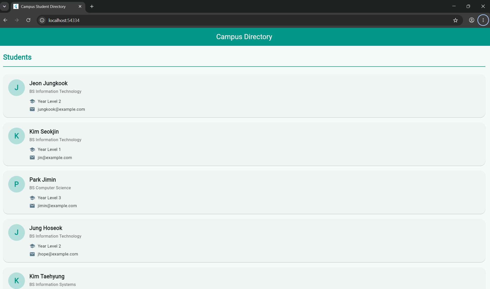

# Jelyn T. Tac-an

## Laboratory Activity 2: Building a Student Directory with Stateless Widget

This Flutter application displays a campus student directory using reusable StatelessWidget classes.

## App Screenshot

